# TypeScript Programming Questions

## 1. Write a TypeScript program to declare your name, age, and city, and display them using console.log().

### Screenshot

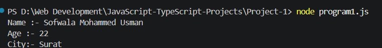

## 2. Write a program to declare two numbers and display:

1. Addition
2. Subtraction
3. Multiplication
4. Division

### Screenshot

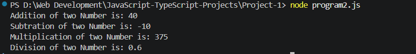

## 3. Write a program to display one message using:

1. console.log()
2. alert()
3. innerHTML

### Screenshot

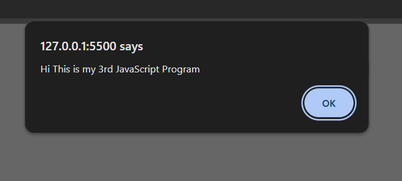

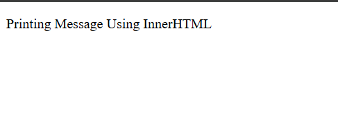

## 4. Write a program to store one number and find its square and cube.

### Screenshot

## 5. Write a program to calculate area of rectangle using:

1. length
2. Width

### Screenshot

## 6. Write a program showing different TypeScript data types:

1. number
2. string
3. boolean

### Screenshot

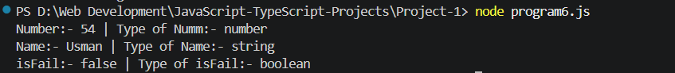

## 7. Write a program to declare one variable using any type and assign different values one by one.

### Screenshot

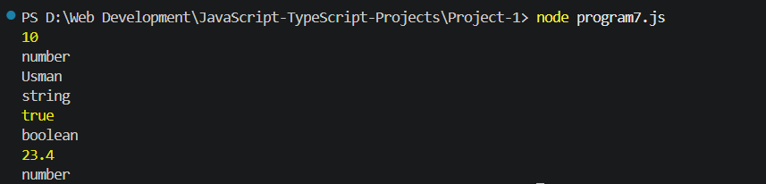

## 8. Write a program to convert string "250" into number and add 50.

### Screenshot

## 9. Write a program to convert number 500 into string and display its type.

### Screenshot

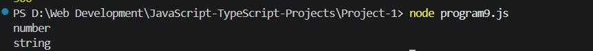

## 10. Write a program to take two string numbers and perform numeric addition after conversion.

### Screenshot

## 11. Write a program to perform all arithmetic operations on two numbers.

### Screenshot

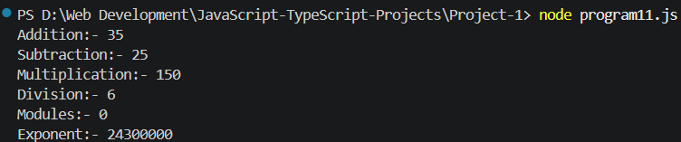

## 12. Write a program to swap two numbers using third variable.

### Screenshot

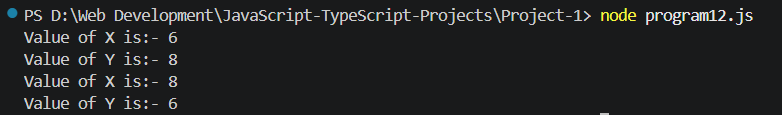

## 13. Write a program to swap two numbers without using third variable.

### Screenshot

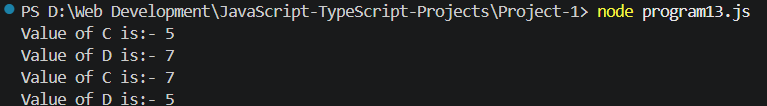

## 14. Write a program to check student grade based on marks:

1. 80 and above = A
2. 60 to 79 = B
3. below 60 = C

### Screenshot

## 15. Write a program to calculate electricity bill:

1. up to 100 units = ₹5 per unit
2. above 100 units = ₹8 per unit

### Screenshot

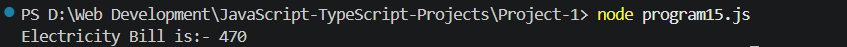

## 16. Write a program to calculate employee total salary using:

1. Basic salary
2. HRA = 10%
3. DA = 5%

### Screenshot

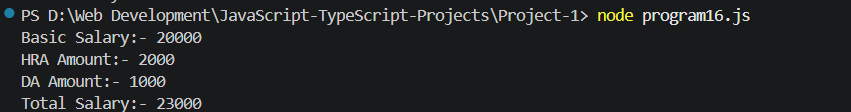

## 17. Write a program to check whether a person is eligible for voting

### Screenshot

## 18. Write a program to calculate discount:

1. purchase above ₹5000 = 15% discount
2. otherwise 5% discount

### Screenshot

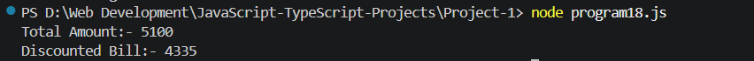

## 19. Write a program to convert Celsius into Fahrenheit.

### Screenshot

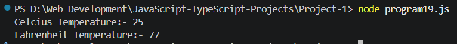

## 20. Write a program to convert minutes into hours and minutes.

### Screenshot

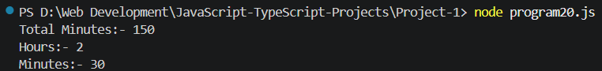
